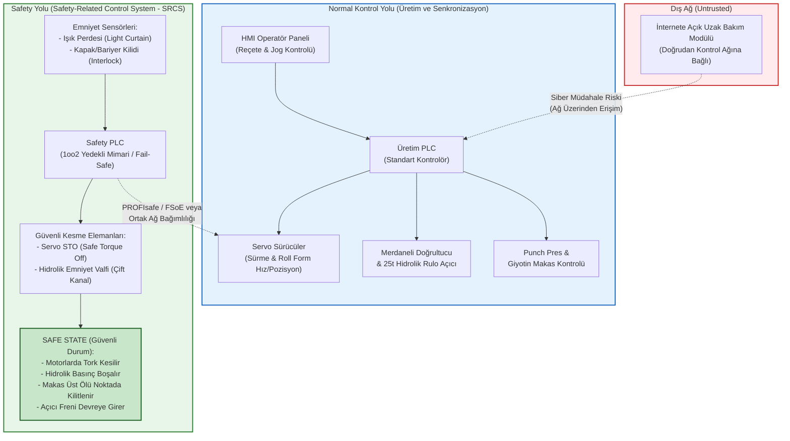

# Hafta 1: Fonksiyonel Emniyet Mimarisi (Safety Architecture)

**İncelenen Sistem:** EAE Makina - Otomatik Rulo Sac Doğrultma, Sürme, Roll Form ve Boy Kesme Hattı  
**Laboratuvar Çıktısı:** Safety Function Map (Emniyet Fonksiyonu Haritası ve Mimari Analiz)

---

## 1. Normal Kontrol Yolu ve Safety Yolu Karşılaştırma Diyagramı

Aşağıdaki mimari diyagramda, hattın günlük üretim operasyonlarını yürüten **Normal Kontrol Yolu** (ve bu yola bağlı olan güvensiz uzak erişim noktası) ile tehlike anında çalışanı korumakla görevli **Fonksiyonel Emniyet Yolu (Safety Path)** karşılaştırmalı olarak modellenmiştir.

---

## 2. Mimari ve Fonksiyonel Emniyet Analiz Soruları

### 1) Bu makinede tehlike nedir, insan neyden zarar görür?
İncelenen rulo sac işleme hattı yüksek tonajlı mekanik ve hidrolik kuvvetlerle çalışmaktadır. Başlıca fiziksel tehlikeler şunlardır:
- **25 Tonluk Sacın Boşalması / Fırlaması:** Hidrolik rulo açıcı üzerindeki 25 tonluk çelik sac rulosunun fren veya tutucu arızası sebebiyle kontrolsüz çözülmesi; yüksek yaylanma enerjisine sahip kalın sacın çarpması sonucu ağır ezilme veya ölüm.
- **Merdanelerde Ezilme ve Kapılma:** Doğrultucu ve roll form istasyonlarındaki yüksek basınçlı döner merdanelerin arasına bakım veya sac besleme (threading) sırasında operatörün elinin/kolunun kapılması ve ezilmesi.
- **Giyotin Makas ve Punch Preste Uzuv Kaybı:** Yüksek hızlı boy kesme makası veya delme presinin operasyon ya da sıkışan sacı düzeltme esnasında beklenmedik şekilde inmesi sonucu el/parmak kopması (amputasyon).

### 2) Safety function (Emniyet Fonksiyonu) hangisidir?
Tanımlanan temel emniyet fonksiyonu şudur: **"Tehlikeli bölgeye girişi denetleyen ışık perdesi ihlal edildiğinde veya koruyucu kapak/bariyer kilidi (interlock) açıldığında; Safety PLC üzerinden servo sürücülerin STO (Safe Torque Off) girişlerini tetikleyerek motor torkunu kesmek ve çift kanallı hidrolik emniyet valflerinin enerjisini keserek giyotin makas ile rulo açıcı hareketini güvenli duruma (Safe State) geçirmek."**

### 3) Safety-related control system (SRCS) şemada nerededir?
Şemada **"Safety Yolu (Safety-Related Control System - SRCS)"** olarak yeşil kutu içerisinde gösterilen alt sistemdir. Bu sistem; giriş birimleri (ışık perdesi ve emniyetli kapı kilitleri), mantık çözücü (Safety PLC) ve çıkış/son kontrol elemanlarından (Servo sürücülerin STO devreleri ve yedekli hidrolik emniyet valfleri) oluşmaktadır.

### 4) Normal PLC ile Safety PLC farkı nedir?
- **Standart (Normal) PLC:** Üretim verimliliği ve süreç sürekliliği için tasarlanmıştır. Tek kanallı (1oo1) işlemci yapısına sahiptir. İçsel bir donanım arızası (örneğin çıkış transistörünün kısa devre olması veya RAM bit hatası) durumunda çıkışı **"1" (enerjili) konumda takılı kalabilir**. Bu durum makinenin durması gerekirken çalışmaya devam etmesine yol açar.
- **Safety PLC:** İnsanı korumak üzere **Fail-Safe (hatada güvenli)** prensibiyle tasarlanmıştır. Genellikle **1oo2 (one-out-of-two)** yedekli mikroişlemci mimarisine sahiptir. İki işlemci sürekli birbirinin sonuçlarını çapraz kontrol (cross-check) eder; bellek testleri, watchdog zamanlayıcıları ve giriş/çıkış darbe testleri (pulse test) uygular. Herhangi bir tutarsızlık veya arıza algılandığında sistem kararsız kalmaz, çıkışları güvenli biçimde enerjisiz bırakarak makineyi doğrudan **Safe State** durumuna geçirir.

### 5) PLr / SIL neden var ve bu fonksiyon için neden önemli?
Her makine tehlikesinin risk düzeyi aynı değildir; dolayısıyla emniyet sisteminin güvenilirlik seviyesi de tehlikenin büyüklüğüyle orantılı olmalıdır. **PLr (Required Performance Level - ISO 13849-1)** ve **SIL (Safety Integrity Level - IEC 62061)**, bir emniyet fonksiyonunun zamana bağlı tehlikeli arıza olasılığını sınırlandıran metriklerdir.
- Bu makinede merdaneye kapılma veya giyotin makas altında kalma tehlikesinin şiddeti **geri döndürülemez uzuv kaybı veya ölüm (S2)** düzeyindedir.
- Operatörün kalıp ayarı, sac sürme ve bakım için tehlikeli bölgeye sık maruz kalması (**F2**) ve yüksek hızlı makas/servo hareketinden kaçınma imkanının çok düşük olması (**P2**) sebebiyle gerekli performans seviyesi **PLr = e (SIL 3)** olarak belirlenmiştir. Bu seviye, sistemin tek bir arıza ile emniyet fonksiyonunu kaybetmemesini (Kategori 3/4 mimari) zorunlu kılar.

### 6) Safe state (güvenli durum) nedir?
Bu hat için **Safe State (Güvenli Durum)**; tüm tehlikeli mekanik ve hidrolik hareket enerjisinin ortadan kaldırıldığı veya kilitlendiği durumdur:
1. Servo sürücülerde **STO (Safe Torque Off)** devreye girerek motor sargılarına giden enerjinin kesilmesi ve sac sürme/merdane dönüşünün durması (üretken tork = 0),
2. Hidrolik emniyet valflerinin enerjisinin kesilerek basıncın tanka boşaltılması (dump),
3. Giyotin makasın ve punch presin yerçekimiyle düşmesini önlemek üzere **üst ölü noktada mekanik/hidrolik emniyet kilidiyle sabitlenmesi**,
4. 25 tonluk rulo açıcının yaylı/kuru tip emniyet freninin (fail-safe brake) kapanarak rulonun kendi ağırlığıyla boşalmasının engellenmesidir.

### 7) Safety function hangi dijital bağımlılıklara sahip?
Geleneksel sabit kablolu (hardwired) röle sistemlerinden farklı olarak modern bir Safety PLC mimarisinde emniyet fonksiyonu şu dijital bileşenlere bağımlıdır:
- **Safety PLC Uygulama Yazılımı ve Konfigürasyonu:** Emniyet mantığını işleten program blokları ve zamanlayıcı (filtre/tepki süresi) ayarları.
- **Emniyetli Endüstriyel Haberleşme Protokolleri:** Işık perdesi, Safety PLC ve servo sürücüler arasındaki sinyallerin taşındığı **PROFIsafe** veya **FSoE (Fail-Safe over EtherCAT)** haberleşme paketleri.
- **Servo Sürücü Dijital Emniyet Parametreleri:** Sürücü içerisindeki **STO (Safe Torque Off)** ve özellikle kalıp ayarı (jog) sırasında kullanılan **SLS (Safely Limited Speed - Güvenli Hız Limiti)** parametre değerleri.

### 8) Siber müdahale hangi noktadan bu fonksiyonu bozar?
Şemada görüldüğü üzere hatta doğrudan bağlı olan **"İnternete Açık Uzak Bakım Modülü"**, siber saldırganlar için birincil giriş noktasıdır:
- Saldırgan, dış ağa açık olan bu bakım modülü üzerinden kontrol ağına (Normal Kontrol Yolu) sızabilir.
- Eğer Safety PLC ile standart PLC bütünleşik bir yapıda çalışıyorsa veya mühendislik yazılımı üzerinden emniyet parametrelerine erişim parolası zayıfsa/devre dışıysa; saldırgan operatörün merdane kalıp ayarı (jog modu) yaptığı sırada **SLS (Güvenli Hız Limiti)** parametrelerini yükseltebilir, emniyet fonksiyonunu bakım (bypass/forcing) moduna alabilir ya da servo sürme hızını manipüle ederek ışık perdesinin tepki süresinden (güvenlik mesafesi hesabından) daha hızlı bir hareket başlatıp çalışanı tehlikeli bölgede yakalayabilir.
