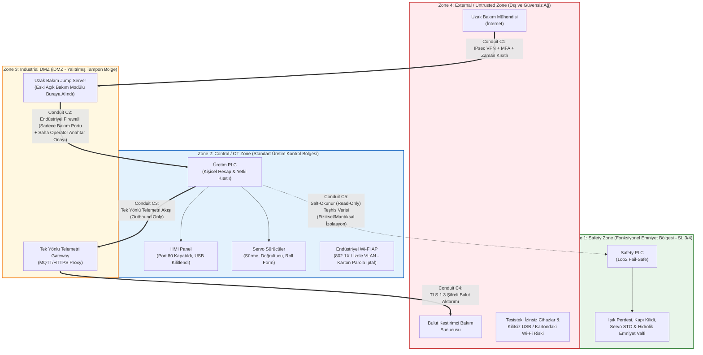

# Hafta 2: IEC 62443 Mini Workshop (Zone & Conduit Modellemesi)

**İncelenen Sistem:** EAE Makina - Otomatik Rulo Sac Doğrultma, Sürme, Roll Form ve Boy Kesme Hattı  
**Laboratuvar Çıktısı:** Zone / Conduit Diagram ve Uzak Erişim Karar Tablosu

---

## 1. Mevcut Varlık Envanteri ve Zafiyet Durumu

Saha incelemesinde rulo sac şekillendirme ve boy kesme hattı üzerinde tespit edilen varlıklar ve güvenlik açıkları şunlardır:
- **Üretim PLC:** Hattın sürme, doğrultma ve kesim senkronizasyonunu yöneten standart kontrolör.
- **Safety PLC:** Işık perdesi, kapı kilitleri, STO ve hidrolik emniyet valflerini yöneten emniyet kontrolörü.
- **HMI Operatör Paneli:** Port 80 (HTTP) üzerinden şifresiz web arayüzü açık durumda.
- **Servo Sürücüler:** Sürme, roll form ve makas pozisyonlamasını yapan sürücü grubu.
- **İnternete Açık Uzak Bakım Modülü:** Doğrudan makine switch'ine takılı ve dış dünyaya açık.
- **Bulut Kestirimci Bakım Telemetrisi:** Rulman sıcaklığı ve hidrolik basınç verilerini dış buluta aktaran modül.
- **Wi-Fi AP (Kablosuz Erişim Noktası):** Saha içinde kablosuz bağlantı sağlıyor; parolası elektrik panosu kapağındaki bir karton üzerinde yazılı.
- **2 Adet Kilitsiz USB Portu:** HMI üzerinde profil kesim reçetelerinin yüklendiği, fiziksel ve yazılımsal olarak kısıtlanmamış portlar.
- **"admin/admin" Servis Hesabı:** Cihazlarda varsayılan ve herkes tarafından bilinen ortak yönetici hesabı.

---

## 2. Görev A: IEC 62443 Zone (Bölge) ve Conduit (Geçiş Yolu) Tasarımı

IEC 62443 standardı kapsamında "derinlemesine savunma" (Defense-in-Depth) sağlamak amacıyla makine üzerindeki varlıklar güvenlik gereksinim seviyelerine göre **4 ayrı bölgeye (Zone)** ayrılmış ve bölgeler arası veri akışları **Conduit (Geçiş Yolu)** kuralları ile sınırlandırılmıştır.

### Zone / Conduit Mimari Diyagramı

### Varlıkların Bölgelere Dağılımı ve Temizlik Önlemleri
1. **Zone 1 (Safety Zone):** `Safety PLC`, ışık perdeleri, emniyet kapı kilitleri, `Servo STO` devreleri ve hidrolik emniyet valfleri bu bölgededir. En yüksek güvenlik seviyesine sahiptir; dış ağdan veya standart OT ağından bu bölgeye yazma (write) ya da parametre değiştirme izni yoktur.
2. **Zone 2 (Control / OT Zone):** `Üretim PLC`, `HMI` ve `Servo Sürücüler` (normal kontrol kanalı) bu bölgededir.
   - *Sertleştirme:* HMI üzerindeki açık **Port 80 (HTTP)** kapatılmış, üzerindeki **2 adet kilitsiz USB portu** fiziksel port kilidi ve işletim sistemi beyaz liste (whitelisting) politikası ile kapatılmıştır. **"admin/admin"** varsayılan servis hesabı silinerek rol tabanlı kişisel hesaplara geçilmiştir. Panodaki kartonda parolası yazan **Wi-Fi AP** ya tamamen kaldırılmalı ya da zorunlu ise kurumsal kimlik doğrulamalı ayrı bir VLAN'a alınarak kontrol ağından izole edilmelidir.
3. **Zone 3 (Industrial DMZ - iDMZ):** Uzaktan erişim için kullanılan **Uzak Bakım Modülü / Jump Server** ve **Bulut Kestirimci Bakım Telemetri Gateway** cihazı bu tampon bölgeye taşınmıştır.
4. **Zone 4 (External / Untrusted):** İnternet, uzak bakım yapan firma ağı, bulut sunucuları ve kontrole tabi olmayan harici USB/Wi-Fi istemcileri bu bölgededir.

### Açık Uzak Bakım Modülü Neden Doğrudan Kontrol Bölgesinde (Zone 2) Kalamaz?
Mevcut durumda internete açık olan uzak bakım modülünün doğrudan Zone 2 (Control/OT Zone) içerisinde yer alması, **dış ağ (Zone 4) ile makine kontrol ağı (Zone 2) arasındaki tüm sınırları ortadan kaldırır (flat network)**.
- Bu modül üzerinde keşfedilecek bir firmware zafiyeti veya çalınan bir kimlik bilgisi (`admin/admin`), saldırganı doğrudan Üretim PLC'si, HMI ve servo sürücülerle aynı yerel ağa (Layer 2/Layer 3) sokar.
- Bu nedenle uzak erişim sonlandırma noktası **kesinlikle Zone 2'de kalamaz; Zone 3 (Industrial DMZ)** içerisine alınmalıdır. Böylece dışarıdan gelen bağlantı önce iDMZ'deki Jump Server üzerinde sonlandırılır, doğrulanır ve denetlenir; makine ağına doğrudan paket yönlendirmesi (bridging/routing) engellenmiş olur.

### Bölgeler Arası Geçişlerde (Conduit) Kontrol Edilecek Unsurlar
- **Conduit C1 (Zone 4 -> Zone 3):** Şifreli VPN tüneli (IPsec/TLS), Çok Faktörlü Kimlik Doğrulama (MFA), kaynak IP kısıtlaması ve zaman bazlı oturum kontrolü.
- **Conduit C2 (Zone 3 -> Zone 2):** Endüstriyel güvenlik duvarı (Firewall) üzerinden derin paket inceleme (DPI), yalnızca Jump Server IP'sinden gelen izinli mühendislik protokollerine izin verilmesi (White-listing), oturum kaydı ve sahadaki fiziksel "Uzak Bakım Onay Anahtarı"nın açık olması şartı.
- **Conduit C3 & C4 (Zone 2 -> Zone 3 -> Zone 4):** Telemetri verisi için yalnızca içeriden dışarıya (Outbound) tek yönlü veri akışı; dış buluttan PLC'ye doğru gelen tüm bağlantı isteklerinin (Inbound) bloklanması.
- **Conduit C5 (Zone 2 <-> Zone 1):** Safety Zone ile Control Zone arasındaki geçiş. Zone 2'den Zone 1'e yalnızca durum izleme amaçlı (salt-okunur / teşhis) veri akışına izin verilir; Zone 2 üzerinden Safety PLC'ye program yükleme, online değişiklik veya force/bypass komutları donanımsal anahtar ve protokol filtresi ile engellenir.

---

## 3. Görev B: Uzak Erişim Karar Tablosu

Sac şekillendirme ve boy kesme hattına yapılacak uzaktan bakım bağlantıları için belirlenen 6 temel mimari karar aşağıda listelenmiştir:

| # | Kontrol Katmanı | Karar / Seçilen Yöntem | Mühendislik Gerekçesi ve Sağladığı Koruma |
| :-: | :--- | :--- | :--- |
| **1** | **Aracı** | **Jump Server** | Uzak bakım mühendisinin kendi bilgisayarından PLC'ye doğrudan (uçtan uca) bağlantı kurmasını engeller; iDMZ içinde izole ve kontrollü bir geçiş noktası sağlar. |
| **2** | **Tünel** | **VPN** | İnternet (Untrusted Zone) üzerinden geçen tüm bakım trafiğinin uçtan uca şifrelenmesini sağlayarak veri dinleme (sniffing) ve araya girme (MitM) saldırılarını önler. |
| **3** | **Kimlik** | **MFA (Çok Faktörlü Doğrulama)** | Bakım parolası sızdırılsa veya tahmin edilse bile, ikinci bir doğrulama faktörü (donanım token / mobil onay) olmadan sisteme giriş yapılmasını engeller. |
| **4** | **Hesap** | **Kişisel Hesap** | Ortak kullanılan `admin/admin` hesabını ortadan kaldırır; sisteme kimin girdiğini ve hangi PLC/servo parametresini değiştirdiğini kişi bazında takip etmeyi (inkar edilemezlik) sağlar. |
| **5** | **Kayıt** | **Tam Oturum Kaydı** | Uzaktan yapılan tüm işlemlerin (ekran videosu, ağ paketleri ve PLC değişiklik logları) kaydedilerek olası bir iş kazası veya siber olay sonrasında geriye dönük incelenmesini (forensics) mümkün kılar. |
| **6** | **Zamanlama** | **Varsayılan Kapalı** | Uzak erişim hattı 7/24 açık bırakılmaz; yalnızca arıza/bakım anında ve **sahadaki operatör fiziksel onay (anahtarlı şalter) verdiğinde** geçici olarak açılır. |
