# Hafta 4: Güvenli Uzak Erişim ve Fonksiyonel Emniyet Köprüsü (Secure Remote Access)

**İncelenen Sistem:** EAE Makina - Otomatik Rulo Sac Doğrultma, Sürme, Roll Form ve Boy Kesme Hattı  
**Laboratuvar Çıktısı:** Secure Architecture (Güvenli Uzak Erişim Mimarisi ve Emniyet Bağımsızlık Gereksinimi)

---

## 1. Görev A: Mevcut Durum (As-Is) ve Hedef Durum (To-Be) Karşılaştırması

Hattın arıza teşhisi ve kalıp/reçete desteği için kullanılan uzak erişim yapısının mevcut güvensiz durumu ile IEC 62443 prensiplerine göre yeniden tasarlanan hedef durumu aşağıda karşılaştırılmıştır.

### Mimari Karşılaştırma Diyagramı

```mermaid
flowchart TB
    subgraph AsIs["MEVCUT DURUM (As-Is: Güvensiz Mimari)"]
        direction LR
        Internet1["İnternet\n(Herhangi Bir IP)"] -->|"Doğrudan Port Açık\n(admin/admin, 7/24 Açık)"| Modem1["Açık Uzak Bakım Modemi"]
        Modem1 -->|"İzolasyon Yok\n(Flat Network)"| OTNet1["Üretim PLC + HMI +\nServo Sürücüler"]
    end

    subgraph ToBe["HEDEF DURUM (To-Be: Güvenli Uzak Erişim Mimarisi)"]
        direction LR
        Vendor["Yetkili Bakım Mühendisi\n(Kişisel Hesap + MFA)"] -->|"1. IPsec/TLS VPN\nŞifreli Tünel"| FW1["Dış Güvenlik Duvarı"]
        FW1 -->|"2. İzole Geçiş"| Jump["iDMZ Jump Server\n(Tam Oturum Video/Log Kaydı)"]
        Jump -->|"3. Fiziksel Onay Şartlı Geçiş"| KeySwitch{"Sahadaki Operatör\nFiziksel Anahtarı\nAçtı mı?"}
        KeySwitch -->|"EVET (Geçici Süre)"| OTNet2["Zone 2: Üretim PLC & HMI"]
        KeySwitch -.->|"HAYIR (Varsayılan Kapalı)"| Block["Erişim Engellendi"]

        subgraph IsolatedSafety["Zone 1: Bağımsız Emniyet Zinciri (Air-Gapped / Read-Only)"]
            SafetyChain["Işık Perdesi + Kapı Kilidi\n--> Safety PLC --> Servo STO & Hidrolik Valf"]
        end

        OTNet2 -. "Yalnızca Salt-Okunur Durum Bilgisi\n(Parametre Değiştirilemez)" .-> IsolatedSafety
    end

    style AsIs fill:#ffebee,stroke:#c62828,stroke-width:2px
    style ToBe fill:#e3f2fd,stroke:#1565c0,stroke-width:2px
    style IsolatedSafety fill:#e8f5e9,stroke:#2e7d32,stroke-width:2px
```

### Mevcut Durum ile Hedef Durumun Teknik Karşılaştırma Tablosu

| Kriter | Mevcut Durum (As-Is) | Hedef Durum (To-Be) |
| :--- | :--- | :--- |
| **Ağ Bağlantı Yapısı** | İnternetten doğrudan PLC ve HMI ağına bağlı açık modem (Flat Network). | iDMZ üzerindeki **Jump Server** üzerinden kademeli ve izole geçiş. |
| **İletişim Kanalı** | Şifresiz veya zayıf yapılandırılmış doğrudan port yönlendirme (Port Forwarding). | Uçtan uca şifreli **VPN tüneli** (IPsec / TLS). |
| **Kimlik Doğrulama** | Tek faktörlü, sabit parola. | **MFA (Çok Faktörlü Kimlik Doğrulama)** zorunluluğu. |
| **Kullanıcı Yönetimi** | Herkesin bildiği ortak `admin/admin` servis hesabı. | Her bakım mühendisi için tanımlı **kişisel hesap** ve en az yetki prensibi. |
| **Denetim ve İzlenebilirlik** | Kayıt yok; kimin ne zaman hangi parametreyi değiştirdiği belirsiz. | Jump Server üzerinde **tam oturum kaydı** (ekran kaydı + PLC değişiklik/audit logları). |
| **Bağlantı Zamanlaması** | 7/24 sürekli açık (Her an saldırıya hazır). | **Varsayılan kapalı (Default Deny)**; yalnızca pano üzerindeki **fiziksel bakım anahtarı** saha operatörü tarafından çevrildiğinde aktif. |

---

## 2. Görev B: Functional Safety (Fonksiyonel Emniyet) Köprüsü

Siber güvenlik önlemleri (VPN, MFA, Jump Server) saldırı olasılığını büyük ölçüde düşürse de fonksiyonel emniyet mühendisliğinde **"siber güvenlik tek başına emniyet fonksiyonunun yerine geçemez"** ilkesi geçerlidir. Bu nedenle en kötü senaryo (saldırganın tüm siber katmanları aşması) ayrıca değerlendirilmelidir.

### 1) Saldırgan tüm önlemleri aşıp içeri girse bile emniyet fonksiyonu etkilenir mi?
**Hayır, etkilenmez.** 

Çünkü hedef mimaride **Normal Kontrol Yolu (Zone 2)** ile **Fonksiyonel Emniyet Yolu (Zone 1)** birbirinden mimari ve elektriksel olarak ayrılmıştır:
- Saldırgan çalınmış bir MFA oturumu veya sıfırıncı gün (zero-day) zafiyeti ile Jump Server'ı aşıp Üretim PLC'sine (Zone 2) ulaşsa ve sac sürme servolarına *"maksimum hızla sür"* ya da giyotin makasa *"kes"* komutu gönderse dahi;
- Tehlikeli bölgeyi koruyan **ışık perdesi ve emniyetli kapı kilitleri doğrudan Safety PLC'ye**, Safety PLC'nin emniyet çıkışları ise doğrudan **Servo sürücülerin donanımsal STO (Safe Torque Off) girişlerine ve çift kanallı hidrolik emniyet valflerine** bağlıdır.
- Operatör merdane veya makas bölgesine elini uzattığı anda ışık perdesi kesilir, Safety PLC üretim PLC'sinin ne söylediğine bakmaksızın sürücülerin tork enerjisini (STO) ve hidrolik valf enerjisini keserek makineyi **Safe State** durumuna geçirir. Saldırgan üretim ağından bu donanımsal kesme yolunu (hardwired/isolated safety loop) geçersiz kılamaz.

### 2) Mühendislik Gereksinim Cümlesi (Requirement Statement)
Tasarım şartnamesine eklenecek olan, nasıl yapılacağını (çözümü) değil sistemin neyi sağlamak zorunda olduğunu belirten **Emniyet ve Siber Güvenlik Bağımsızlık Gereksinimi** şu şekildedir:

> **Gereksinim [REQ-SAF-SEC-01]:**  
> *"Işık perdesi, kapı kilidi, Safety PLC ve STO'dan oluşan emniyet zinciri; uzaktan bakım ve üretim ağından bağımsız olmalı, uzaktan erişim ile hiçbir emniyet parametresi değiştirilememelidir."*
