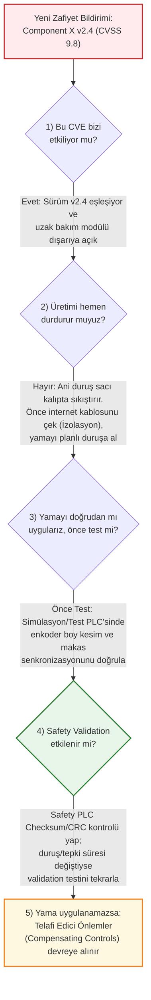

# Hafta 5: SBOM, CVE Analizi ve Yama Yönetimi (SBOM / CVE / Patch)

**İncelenen Sistem:** EAE Makina - Otomatik Rulo Sac Doğrultma, Sürme, Roll Form ve Boy Kesme Hattı  
**Laboratuvar Çıktısı:** Vulnerability Decision (Zafiyet Müdahale ve Karar Akışı)

---

## 1. Senaryo ve Verilen Zafiyet Bilgisi (SBOM Eşleşmesi)

Hattın yazılım bileşen envanteri (**SBOM - Software Bill of Materials**) takip edilirken, PLC üreticisi ve siber güvenlik bültenleri tarafından aşağıdaki kritik zafiyet bildirimi yayınlanmıştır:

| Parametre | Değer |
| :--- | :--- |
| **Etkilenen Bileşen** | PLC Firmware Haberleşme Kütüphanesi (*Component X*) |
| **Mevcut Sürüm** | `v2.4` |
| **CVE Kodu** | `CVE-XXXX-XXXX` |
| **Önem Derecesi** | **Critical (CVSS 9.8)** - Uzaktan Kod Çalıştırma / Yetkisiz Komut Gönderme |
| **Yama (Patch) Durumu** | **Mevcut** (Üretici tarafından yeni firmware yayınlandı) |

---

## 2. 5 Soruluk Mühendislik Karar Akışı

Endüstriyel kontrol sistemlerinde (OT) bir yama yayınlandığında, ofis bilgisayarlarındaki (IT) gibi otomatik güncelleme yapılamaz. Yanlış zamanda veya test edilmeden atılan bir PLC yaması, fiziksel makine senkronizasyonunu bozarak kazaya veya ağır mekanik hasara yol açabilir. Bu doğrultuda izlenen 5 adımlı karar akışı aşağıdadır:

---

### 1) Bu CVE bizi etkiliyor mu?
**Evet, doğrudan etkiliyor.**  
Yapılan SBOM kontrolünde üç temel kriterin aynı anda gerçekleştiği tespit edilmiştir:
1. **Bileşen Varlığı:** Hattı yöneten PLC içerisinde *Component X* haberleşme kütüphanesi kullanılmaktadır.
2. **Sürüm Eşleşmesi:** PLC üzerindeki mevcut firmware sürümü zafiyetli olan **Sürüm 2.4** ile birebir eşleşmektedir.
3. **Erişilebilirlik (Exploitability):** Makineye bağlı olan uzak bakım modülü dış ağa (internete) açık durumdadır; yani saldırgan bu haberleşme kütüphanesine dışarıdan paket gönderebilecek erişim yoluna sahiptir.

---

### 2) Üretimi hemen durdurur muyuz?
**Hayır, üretimi aniden durdurmayız; ancak derhal ağ izolasyonu uygularız.**  
- **Teknik Gerekçe:** 25 tonluk rulo açıcı, doğrultucu, roll form istasyonları ve giyotin makastan oluşan ağır bir sac işleme hattını üretim ortasında aniden durdurmak veya çalışma esnasında PLC'ye firmware yüklemeye kalkmak; kalın çelik sacın roll form kalıpları ve merdaneler arasında sıkışmasına, hidrolik darbelere ve ciddi mekanik hasara/iş güvenliği riskine neden olur.
- **Acil Müdahale Adımı:** Üretim devam ederken ilk iş olarak **uzak bakım modülünün internet kablosu fiziksel olarak çekilir** (dış bağlantı kesilir). Böylece CVSS 9.8'lik zafiyet dış dünyadan **erişilemez (unexploitable)** hale getirilir. Firmware yaması ise vardiya sonundaki veya hafta sonundaki **planlı bakım duruşunda** uygulanır.

---

### 3) Yamayı doğrudan mı uygularız, önce test mi?
**Kesinlikle doğrudan hat üzerindeki PLC'ye uygulanmaz; önce test edilir.**  
- Firmware güncellemeleri, PLC'nin çevrim süresini (scan time), kesme (interrupt) önceliklerini veya haberleşme zamanlamalarını milisaniye düzeyinde değiştirebilir.
- Bu hatta servo sürücüler, enkoder üzerinden sac sürme boyunu ölçmekte ve giyotin makas ile punch presi yüksek hızda senkronize etmektedir.
- Bu nedenle yama önce **test panosunda veya yedek/simülasyon PLC'sinde** denenir; enkoder okuma hassasiyetinin, boy kesim toleranslarının ve servo-makas senkronizasyonunun bozulmadığı doğrulandıktan sonra gerçek üretime yüklenir.

---

### 4) Safety validation (Emniyet Doğrulaması) etkilenir mi?
**Kontrol edilmelidir; etkileniyorsa doğrulama (validation) tekrarlanır.**  
Fonksiyonel emniyet standartlarına (ISO 13849-2 / IEC 62061) göre onaylanmış bir emniyet sisteminde yapılan her değişiklik izlenmelidir:
1. **Safety Signature (Checksum / CRC) Kontrolü:** Yama işlemi sonrasında Safety PLC içerisindeki emniyet programının **CRC / Checksum imzasının** değişip değişmediği mühendislik yazılımından kontrol edilir.
2. **Tepki Süresi (Response Time) Doğrulaması:** Eğer güncelleme Safety PLC'nin haberleşme katmanını (örneğin PROFIsafe/FSoE sürücüsünü) veya işlemci döngüsünü etkilediyse; ışık perdesi kesildiği andan Servo STO ve hidrolik valfin kapanmasına kadar geçen **toplam duruş süresi** yeniden ölçülmeli ve güvenlik mesafesi hesabının bozulmadığı **Safety Validation testi** ile kayıt altına alınmalıdır.

---

### 5) Yama mümkün değilse telafi edici önlem (Compensating Control) ne olur?
Eğer yama test aşamasında makine senkronizasyonunu bozduğu için uygulanamıyorsa veya PLC donanım revizyonu yeni firmware'i desteklemiyorsa, riski kabul edilebilir seviyeye indirmek için aşağıdaki **telafi edici kontroller (compensating controls)** devreye alınır:
1. **Dış Ağ Bağlantısının Kesilmesi:** Uzaktan bakım için kullanılan doğrudan internet bağlantısı kalıcı olarak iptal edilir; bakım yalnızca yerel olarak veya fiziksel anahtar onaylı izole Jump Server üzerinden yapılır.
2. **Endüstriyel Güvenlik Duvarı (Firewall) ve Port Kısıtlaması:** PLC'nin önüne endüstriyel bir güvenlik duvarı konularak *Component X* haberleşme kütüphanesinin kullandığı zafiyetli portlar dışarıdan gelen tüm isteklere kapatılır; yalnızca HMI'nın IP/MAC adresinden gelen izinli trafiğe (whitelisting) izin verilir.
3. **Fiziksel Anahtar Kilidi (Hardware Keyswitch):** PLC üzerindeki fiziksel mod anahtarı **RUN (Salt-Okunur Çalışma)** konumuna alınarak anahtar çıkarılır ve kilitlenir; böylece ağ üzerinden uzaktan firmware yükleme veya program değiştirme komutları donanımsal olarak reddedilir.
